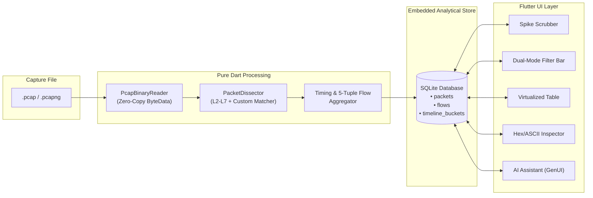

# Packet Inspector 🔍📡

**AI-Powered Cross-Platform PCAP & PCAPNG Network Traffic Inspector**

Packet Inspector is a modern desktop and web-ready network traffic analyzer built in Flutter that eliminates Wireshark's arcane filter syntax (`tcp.analysis.retransmission && ip.addr == 10.0.0.1`), visualizes timing anomalies ($\Delta t$), provides 1-click baseline triage, and integrates conversational AI investigation with interactive GenUI charts.

---

## Key Features

- **🚀 Dual-Mode Traffic Filtering:**
  - **Baseline Triage Mode:** Categorizes traffic into **Expected**, **Unclassified**, and **Unexpected** with a one-click **"Silence LAN Chatter"** toggle (auto-silences ARP, mDNS, SSDP, NBNS, and DHCP broadcast noise).
  - **Quick-Filter Pill Mode:** Toggling Triage Mode OFF transforms the header into interactive, scrollable protocol and IP pills with packet counts.
- **⏱️ Synchronized $\Delta t$ Timeline Spike Scrubber:**
  - Plots **Global Capture $\Delta t$** (detecting traffic micro-bursts) and **5-Tuple Stream $\Delta t$** (detecting application latency and TCP stalls).
  - Drag-to-brush zoom allows drilling down into any timing spike instantly.
- **📊 Virtualized Packet Table:**
  - Color-coded delta-time badges highlight bursts (<0.05ms) and stalls (>100ms).
  - Right-click context menu:
    - *Add to Protocol Library...*
    - *Mark Source/Dest IP as Expected*
    - *Flag Source/Dest IP as Unexpected*
    - *Filter by this 5-Tuple Flow*
- **🧩 Interactive Hex & ASCII Byte Inspector:**
  - Side-by-side hexadecimal and ASCII display with byte offset markers.
  - Click-and-drag byte selection with **"Use Selection as Magic Bytes"** to create custom protocol rules in seconds.
  - Decodes and displays named custom protocol field slices right above the hex dump.
- **🏷️ User-Defined Custom Protocol Library:**
  - **Tier 1:** Transport (TCP/UDP), Port, Direction (Src/Dst/Either), and optional IP filter.
  - **Tier 2:** Fixed-offset Magic Bytes (Hex or ASCII).
  - **Field Slices:** Named fields extracted at fixed offsets (`uint8`, `uint16Be`, `uint16Le`, `uint32Be`, `uint32Le`, `asciiString`, `hexBytes`).
  - **Retroactive Re-Labeling:** Adding a rule re-labels existing packets in SQLite in `<50ms` without re-reading the file!
- **🤖 AI Investigation Assistant (Cloud Gemini + Local Gemma via Ollama/LAN):**
  - Parameterized deterministic tools prevent small local models from hallucinating:
    - `get_capture_summary`: Renders protocol breakdown pie chart and triage breakdown.
    - `get_top_talkers`: Renders conversation bar chart and table with 1-click CSV export.
    - `find_timing_anomalies`: Identifies traffic spikes with **"Jump to Spike"** timeline zoom buttons.
    - `suggest_custom_protocol_signature`: Analyzes unknown ports and suggests magic byte signatures automatically.
- **💾 Smart CSV Export:**
  - Export filtered packets, 5-tuple flows, or dynamic AI tables.
- **⚡ 100% Pure Dart + SQLite Engine:**
  - Zero C/Rust FFI build toolchain headaches.
  - Parses classic `.pcap` (microsecond & nanosecond, Big/Little Endian) and `.pcapng` (SHB, IDB, EPB).
  - Batch indexed into embedded SQLite (`sqlite3`) for sub-millisecond querying.

---

## Architecture



---

## Getting Started

### Prerequisites
- [Flutter SDK](https://docs.flutter.dev/) (3.13+ / 3.47+)
- Standard platform build dependencies (e.g. `clang`, `cmake`, `ninja-build`, `libgtk-3-dev` on Linux)

### Run the App

```bash
# Clone the repository
git clone https://github.com/Tom-McGuire/Packet-Inspector.git
cd Packet-Inspector

# Install dependencies
flutter pub get

# Run on Linux Desktop
flutter run -d linux

# Run on macOS or Windows
flutter run -d macos
flutter run -d windows
```

### Run Tests

```bash
flutter test
```

### Static Analysis

```bash
flutter analyze
```

---

## License

MIT License.
