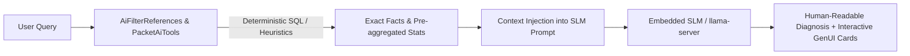

# Embedded Local AI Options & Architecture Guide

This guide details options, architectures, and implementation pathways for embedding a local Small Language Model (SLM) directly into **Packet Inspector** for completely offline, air-gapped environments (e.g., server rooms with no WAN access).

---

## 1. Multi-Tier AI Architecture

Packet Inspector is designed around a multi-tier AI backend hierarchy configured in `LlmProviderService`:

| Tier | Backend Mode | Execution Location | Dependencies | Primary Use Case |
| :--- | :--- | :--- | :--- | :--- |
| **Tier 1** | `deterministicLocal` | Built-in Dart / SQLite | None (0 MB model, instant) | Baseline capture math, protocol breakdown, exact timing spikes, zero hallucinations. |
| **Tier 2** | `embeddedLlm` *(Planned)* | In-process or app-bundled subprocess | Bundled binary or C++ FFI + quantized GGUF (~0.8–1.5 GB) | Offline conversational analysis, filter translation, error diagnostics in server rooms. |
| **Tier 3** | `localGemma` | External service (`localhost:11434`) | Ollama / LM Studio running on laptop or LAN | Leveraging larger 8B–14B models when workstation GPU is available. |
| **Tier 4** | `geminiCloud` | Google Cloud API | Internet connectivity + API key | Deep threat research, expansive multi-step reasoning, external threat intel. |

---

## 2. Technical Approaches for Flutter Desktop (Windows/macOS/Linux)

### Approach A: Bundled Headless Sidecar (`llama-server`) — **Recommended**
* **Mechanism:** Bundle a lightweight pre-compiled `llama-server` binary (~18 MB) inside the application package (e.g., in `assets/bin/` or next to the executable).
* **Execution:** When the user selects "Embedded SLM" mode, Flutter launches `llama-server` on a dynamic localhost port (e.g., `127.0.0.1:54321`) pointing to a bundled or downloaded `.gguf` weights file.
* **Why this is the best path:**
  1. **Reuses Existing Client Code:** `llama-server` natively exposes the OpenAI-compatible `/v1/chat/completions` REST API, identical to what `_callOllamaApi()` already uses in `llm_provider_service.dart`.
  2. **Process Isolation & Stability:** Heavy CPU/VRAM inference runs in its own memory space. If the model crashes or exhausts RAM, the Flutter UI thread remains completely unaffected.
  3. **Multi-Platform Support:** Pre-compiled binaries for Windows (DirectML/Vulkan/CPU), macOS (Metal), and Linux (Vulkan/CPU) are maintained upstream by `llama.cpp`.

### Approach B: In-Process C++ FFI (`llama_cpp_dart`)
* **Mechanism:** Bundle `llama.dll` (Windows), `libllama.dylib` (macOS), or `libllama.so` (Linux) and load them into Dart via `dart:ffi` inside a background `Isolate`.
* **Pros:** Single unified process; no local TCP socket binding (useful on hyper-restricted enterprise laptops where localhost port binding is blocked by security software).
* **Cons:** Native memory management in Dart isolates can be tricky; any native segfault terminates the entire desktop application.

---

## 3. Recommended Small Language Models (SLMs)

For CPU inference on laptops in field/server-room environments, models in the **0.5B to 2B parameter range** quantized to 4-bit (`Q4_K_M`) strike the optimal balance between speed, size, and reasoning quality:

| Model | Format / Quant | Storage Size | RAM Overhead | Inference Speed (CPU) | Strengths |
| :--- | :--- | :--- | :--- | :--- | :--- |
| **Qwen 2.5 Coder 1.5B** *(Top Pick)* | GGUF Q4_K_M | ~1.1 GB | ~1.6 GB | ~15–25 tokens/s | Outstanding at structured syntax, Wireshark/BPF filters, and troubleshooting logic. |
| **Llama 3.2 1B** | GGUF Q4_K_M | ~800 MB | ~1.2 GB | ~20–35 tokens/s | Fast conversational responses, compact footprint. |
| **SmolLM2 1.7B** | GGUF Q4_K_M | ~1.0 GB | ~1.4 GB | ~15–22 tokens/s | Trained specifically on clean reasoning datasets; low latency. |
| **Qwen 2.5 0.5B** | GGUF Q4_K_M | ~350 MB | ~600 MB | ~40+ tokens/s | Ultra-lightweight; ideal for basic query-to-filter mapping. |

---

## 4. The "Hybrid" Architecture: Pairing Exact Engine with SLM

Small language models should **not** be tasked with computing raw byte offsets or calculating millisecond delta distributions over thousands of packets. Instead, Packet Inspector uses a **two-phase hybrid pattern**:

1. **Deterministic Layer (Dart & SQLite):** Computes top talkers, packet counts, spike timestamps, and custom protocol aliases with 100% precision.
2. **Context Enrichment:** Injects this structured summary into the SLM system prompt.
3. **Embedded SLM Layer:** Formats the natural-language explanation, translates user intent into filter expressions, and answers follow-up diagnostic questions.

---

## 5. Storage & Delivery Strategy

* **Core App Installer:** Ship Packet Inspector with the fast offline **Deterministic Engine** built in.
* **On-Demand Model Download:** Add a button in the AI Assistant settings dialog:
  * *"Download Offline Packet Model (~1.1 GB)"*
  * Saves `qwen2.5-coder-1.5b-instruct-q4_k_m.gguf` to `getApplicationSupportDirectory()`.
  * Allows offline air-gapped technicians to preload the weights once before entering the server room or copy the file over USB.
